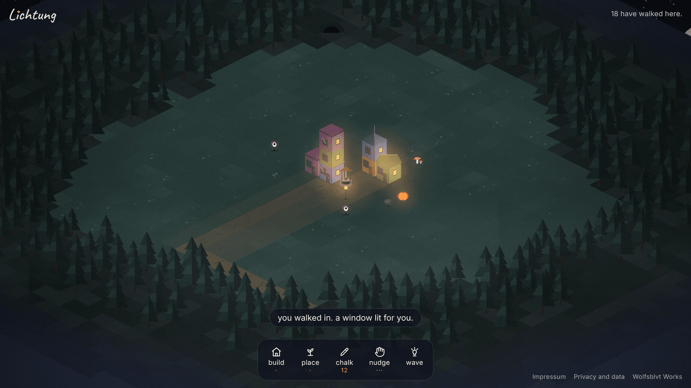
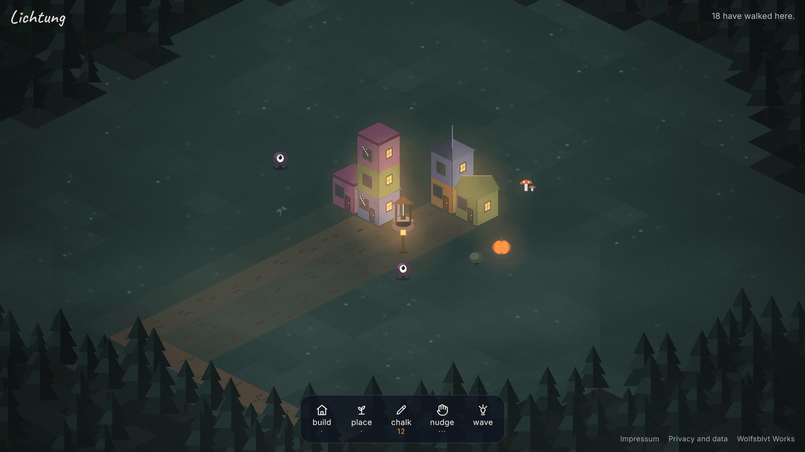

<h1 id="lichtung">
  <picture>
    <source media="(prefers-color-scheme: dark)" srcset="brand/bundle/lichtung/assets/wordmark/on-dark.svg">
    
  </picture>
</h1>

**A small clearing in the woods that exists only because people came by.**

Every visitor leaves a light. A tiny figure walks in from the edge of the woods, the ground wears a little where it
walked, and a window lights up and stays lit for a while before settling to an ember that never goes out. Most
visitors do one more small thing before they leave: build a room onto the settlement, put a lantern or a sapling on
the ground, chalk a few pixels onto a slate, or shoo one of the little ones a step along. Nothing is ever torn down.
The place is what everyone who was ever there has made of it, together, and it keeps changing a little while nobody
is watching.

It is one page, drawn live on a canvas, with no account, no name and nothing stored on your device. Walking in takes
ten seconds; staying a minute or two is the idea.

**[Walk into the clearing](https://lichtung.wolfsblvt.workers.dev/)** · [How it is built](docs/ARCHITECTURE.md) · [Where it is going](docs/VISION.md)

## What you get

- **Arrival leaves a trace.** Connecting is a visit: the figure walks in, the path wears, a window lights, the count
  goes up. Anyone else there at that moment sees it happen.
- **Five quiet verbs.** Build one room (on top of a stack or beside one), place one thing from a hand of three,
  chalk up to a dozen cells on any slate, nudge a creature three times, wave to whoever is here. Every verb also has
  a keyboard route, including "let the clearing choose".
- **A world with its own clock.** Saplings grow over days, embers cool over a week, the little ones wander, and now
  and then something odd happens: a window with eyes, a hum from the cave, something tall crossing the moon.
- **Additive by rule.** Rooms are never removed, chalk is never cleared, things are never picked up. "Never destroy,
  never change too much" is enforced by the rules of the place, not by moderation.

## Run it yourself

1. Node.js 22.18 or newer.
2. From `website/`: `npm ci`, then `npm run dev:worker`.
3. Open `http://127.0.0.1:8787/`. A figure walks in, a window lights, and the verbs along the bottom work against a
   local world kept in a SQLite file under `website/.wrangler/`.

`npm test` runs the Astro check, the Worker type-check, the world-rule tests and the static build. The complete guide
is [docs/DEVELOPMENT.md](docs/DEVELOPMENT.md).

## Trust, privacy and compatibility

The page sets no cookies and uses no browser storage. Everything a visitor leaves is anonymous, public and permanent
by design; nothing links it back to a person. Cloudflare receives the ordinary request data to serve the page and
holds a per-address rate-limit counter in memory for a minute. The live pages at `/privacy/` and `/impressum/` say
exactly this. The clearing needs a browser with Canvas 2D and WebSockets; it honours the reduced-motion preference by
removing drift and walking while keeping the place legible.

## Where it stands

The world runs in one Cloudflare Durable Object and is published as one Worker. The first cut is deployed by hand to
the Workers subdomain as bootstrap evidence; the canonical hostname, the publication workflow's credentials and the
GitHub remote are open owner choices recorded in [docs/DEPLOYMENT.md](docs/DEPLOYMENT.md) and
[docs/DECISIONS.md](docs/DECISIONS.md). The dream, including the parts not built yet, is in [docs/VISION.md](docs/VISION.md).

## License

Copyright © Wolfsblvt. All rights reserved.

This private repository is not offered under a public or general licence. Its contents may be used, copied, modified,
disclosed, or distributed only within permission explicitly granted by the copyright holder. Access to the repository
or receipt of a copy grants no additional rights. The wordmark lettering derives from Caveat, used under the SIL Open
Font License 1.1 (`brand/source/lichtung/caveat-OFL.txt`).
